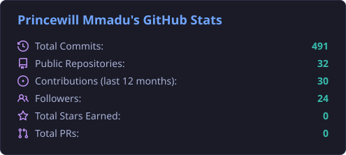
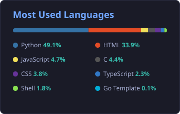

  
  
  

  
  
  

##  About Me

I'm **Princewill Mmadu**, a Backend Software Engineer based in Nigeria. I build server-side applications with **Python and Django**, design relational databases, and ship REST APIs that web and mobile clients can rely on. Alongside engineering I work on **AI data annotation and LLM evaluation**: assessing model responses for accuracy, instruction-following and overall quality.

- 🎓 Trained through the **ALX Software Engineering programme** (Holberton-based curriculum), from C and shell scripting to a backend specialisation in Python, SQL, authentication, caching and queuing
- 🧱 Built **Learn Urhobo**, a Django REST Framework + JWT backend and Expo mobile app for learning the Urhobo language
- 🗄️ Comfortable with **PostgreSQL, MySQL and SQLite** through the Django ORM and SQLAlchemy; have also worked with MongoDB and Redis in Node.js
- 🧪 Evaluate LLM outputs and prompts for quality assurance, and explore AI agent workflows
- 🌱 Currently deepening **Docker, CI/CD and automated testing**

## 🛠️ Technology Stack

  

 

<table align="center">
  <tr>
    <td align="right"><b>Languages</b></td>
    <td>
      
      
      
      
      
      
      
      
    </td>
  </tr>
  <tr>
    <td align="right"><b>Backend &amp; APIs</b></td>
    <td>
      
      
      
      
      
      
      
    </td>
  </tr>
  <tr>
    <td align="right"><b>Databases</b></td>
    <td>
      
      
      
      
      
      
    </td>
  </tr>
  <tr>
    <td align="right"><b>Frontend</b></td>
    <td>
      
      
      
      
      
      
    </td>
  </tr>
  <tr>
    <td align="right"><b>Tools &amp; DevOps</b></td>
    <td>
      
      
      
      
      
      
      
    </td>
  </tr>
  <tr>
    <td align="right"><b>AI &amp; Evaluation</b></td>
    <td>
      
      
      
      
    </td>
  </tr>
</table>

## 🚀 Currently Working On

- 📱 Extending **[Learn Urhobo](https://github.com/Blueskale/learn-urhobo)**: next on the roadmap are audio pronunciations, more lesson content and password reset for the API
- 🤖 **LLM response evaluation**: rating model outputs for accuracy, instruction-following and prompt quality
- 🐳 Learning **Docker and CI/CD**: the GitHub Action that regenerates the stats cards on this profile is one of the experiments
- 🧩 Exploring **AI agent workflows** and AI-assisted developer tooling
- 🐍 Sharpening Python fundamentals with small, dependency-free tools like **[Task Tracker CLI](https://github.com/Blueskale/task-tracker-cli)**

## 📂 Featured Projects

<table>
  <tr>
    <td width="50%" valign="top">
      <h3 align="center"><a href="https://github.com/Blueskale/learn-urhobo">📱 Learn Urhobo</a></h3>
      

        
        
        
        
        
        
      

      
Duolingo-style app for learning Urhobo, a language of Delta State, Nigeria. Django REST Framework backend with JWT authentication, a course → unit → lesson curriculum, four quiz question types graded server-side, XP and daily streaks, and an Expo/React Native client. PostgreSQL with Docker Compose for local development.

    </td>
    <td width="50%" valign="top">
      <h3 align="center"><a href="https://github.com/Blueskale/flexyguardian">🛡️ FlexiGuardian</a></h3>
      

        
        
        
        
        
      

      
ALX portfolio project built with Dulgan Danjuma: a trust platform where clients rate and review service providers and both sides track contracts from creation to completion or dispute. Flask app with Jinja templates plus a JSON API, SQLAlchemy models on MySQL, session auth for the web and JWT for the API.

    </td>
  </tr>
  <tr>
    <td width="50%" valign="top">
      <h3 align="center"><a href="https://github.com/Blueskale/user_authentication_sytem">🔐 Django User Authentication System</a></h3>
      

        
        
        
        
      

      
Complete registration, login/logout and profile flow on Django's auth framework: a custom registration form with email, profiles with image uploads created automatically through signals, crispy-forms rendering and a small blog app. Verified on Django 4.2 LTS.

    </td>
    <td width="50%" valign="top">
      <h3 align="center"><a href="https://github.com/Blueskale/AirBnB_clone_v3">🏠 AirBnB Clone (ALX, four phases)</a></h3>
      

        
        
        
        
        
      

      
A backend built up in four phases: an OOP data layer with JSON file storage and a <code>cmd</code>-based console (<a href="https://github.com/Blueskale/AirBnB_clone">v1</a>), MySQL/SQLAlchemy storage with Flask pages and Fabric deployment (<a href="https://github.com/Blueskale/AirBnB_clone_v2">v2</a>), a RESTful Flask API with full CRUD and Swagger docs (<a href="https://github.com/Blueskale/AirBnB_clone_v3">v3</a>), and a dynamic jQuery front end consuming that API (<a href="https://github.com/Blueskale/AirBnB_clone_v4">v4</a>).

    </td>
  </tr>
  <tr>
    <td width="50%" valign="top">
      <h3 align="center"><a href="https://github.com/Blueskale/task-tracker-cli">✅ Task Tracker CLI</a></h3>
      

        
        
        
      

      
Dependency-free command-line task manager in Python: add, update and delete tasks, mark them in-progress or done, and filter by status, with everything persisted to a local JSON file.

    </td>
    <td width="50%" valign="top">
      <h3 align="center"><a href="https://github.com/Blueskale/consultancy-site">🌐 B&amp;K Consult Ltd Website</a></h3>
      

        
        
        
        
        
      

      
Production marketing site for a Nigerian training and consulting firm, <a href="https://consultancy-site-gamma.vercel.app">live on Vercel</a>. Next.js 16 App Router, React 19, Tailwind CSS 4 and Framer Motion, with a server-side contact API route that validates input and sends HTML email through Nodemailer.

    </td>
  </tr>
</table>

<b>More projects</b>

 
<ul>
  <li><a href="https://github.com/Blueskale/alx-files_manager">alx-files_manager</a>: file hosting API in Node.js/Express with MongoDB, Redis, token-based auth, pagination and Bull background workers for thumbnails</li>
  <li><a href="https://github.com/Blueskale/alx-backend-user-data">alx-backend-user-data</a>: PII-safe logging, password hashing, Basic and Session authentication in Flask</li>
  <li><a href="https://github.com/Blueskale/alx-backend">alx-backend</a>: pagination, caching strategies (FIFO/LIFO/LRU/MRU/LFU), i18n with Flask-Babel and a Redis queuing system</li>
  <li><a href="https://github.com/Blueskale/alx-backend-python">alx-backend-python</a>: type annotations, async/await and unit and integration testing in Python</li>
  <li><a href="https://github.com/Blueskale/My-new-work">My-new-work</a>: WellMed Homes, a responsive care-home landing page in HTML, CSS and vanilla JavaScript</li>
</ul>

## 📊 GitHub Statistics

  
  
    
  
   
  The statistics and language cards are regenerated every day from the GitHub API by <a href=".github/workflows/profile-assets.yml">a GitHub Action in this repository</a>.

## 🐍 Contribution Activity

  <picture>
    <source media="(prefers-color-scheme: dark)" srcset="https://raw.githubusercontent.com/Blueskale/Blueskale/output/github-contribution-grid-snake-tokyo.svg" />
    <source media="(prefers-color-scheme: light)" srcset="https://raw.githubusercontent.com/Blueskale/Blueskale/output/github-contribution-grid-snake.svg" />
    
  </picture>

## 📫 Contact &amp; Social Links

  
  
  
  
  
The quickest way to reach me is LinkedIn or email.

